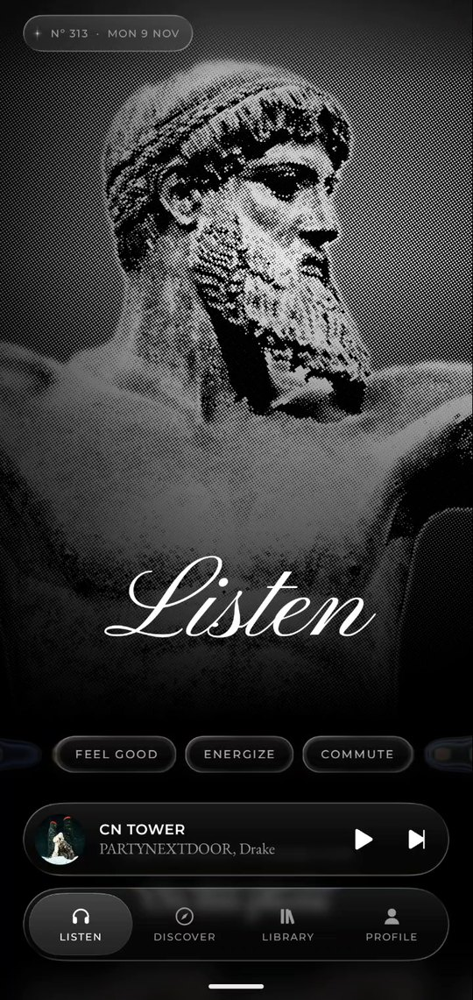
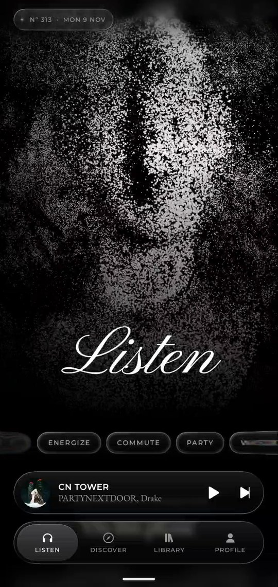
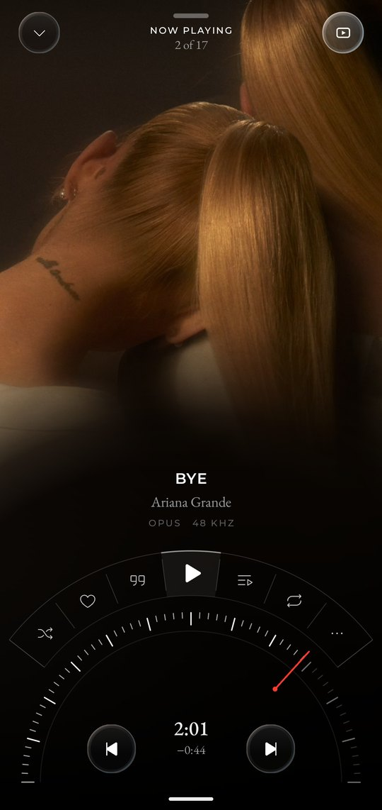
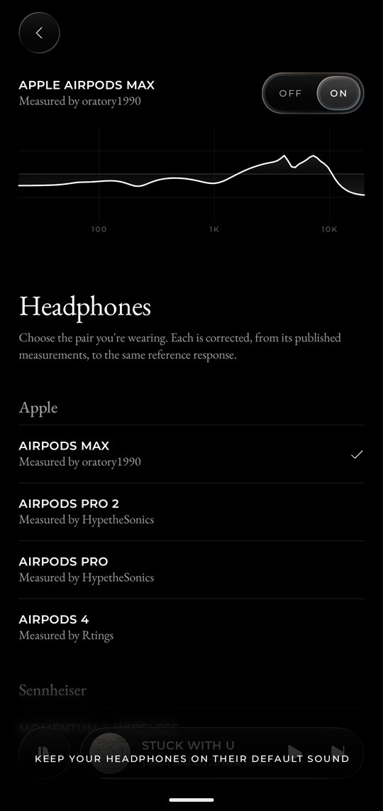
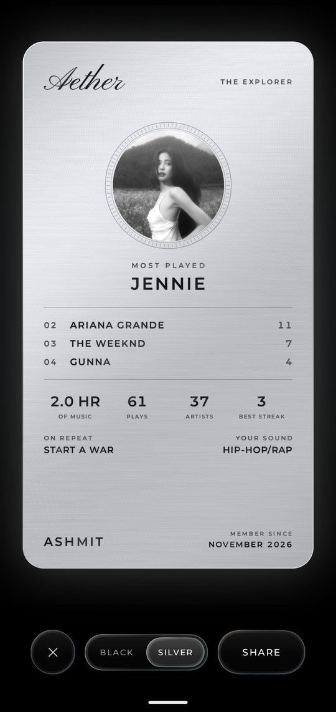
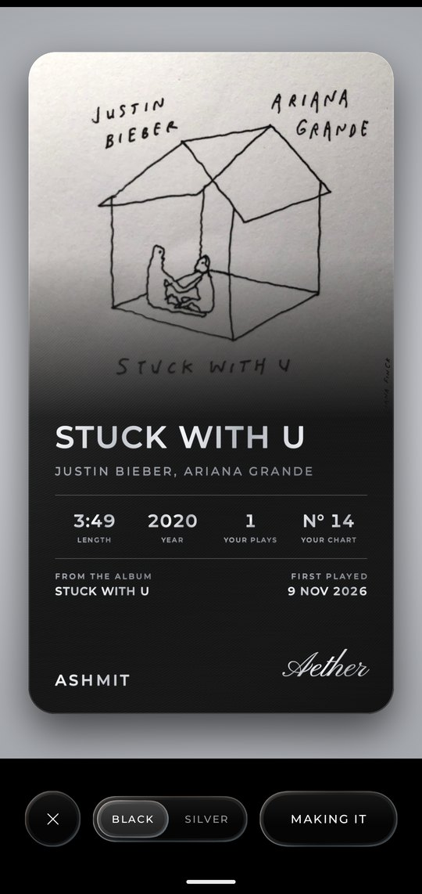
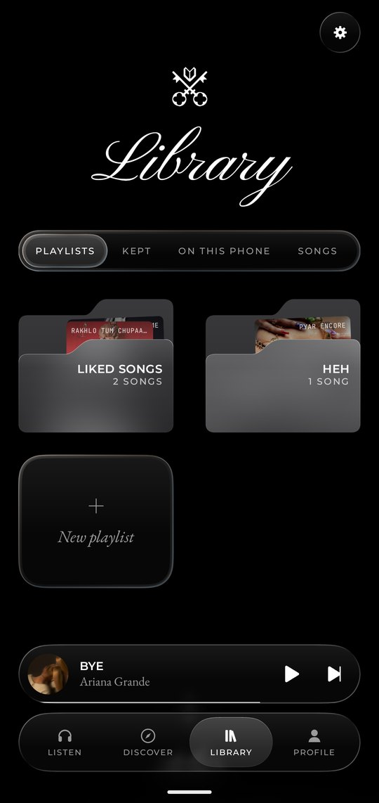
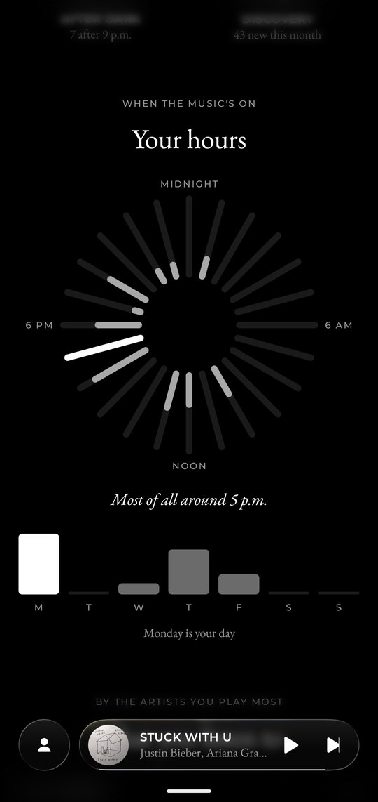

<h1 align="center">AETHER</h1>

<p align="center">
A music app for Android. YouTube Music's catalogue, the sound first,<br>
in a black and white world of glass, halftone and type.
</p>

<p align="center">
  
  
  
  
</p>

<p align="center">
  
  
  
  
</p>

AETHER is built for people who care how music looks and sounds. Its background is pure black, its pictures are black and white, and the only colour on screen comes from the music's own covers. Every label about sound quality is measured. If the app can't measure it, it says nothing.

Version 0.1.0, in final polish. Android 10 or later, portrait only.

## What's in it

**Listening**
- The whole YouTube Music catalogue: Home, Explore, Charts by country, Moods and genres, albums, artists, playlists, podcasts, search and radio. Works as a guest, or signed in on Google's own page.
- Your own music from the phone, with folders chosen in Settings.
- Songs kept for offline, one at a time or whole playlists that pick up new additions on Wi-Fi.
- Sources you add yourself, by address, using the open addon protocol.

**Now Playing**
- A dial for seeking, and a cover you can touch to see it as a print, halftone, ASCII or dither.
- The album's short film, in colour, for albums that have one. The cover shows first and the film takes over once it has loaded, fading in an arc round the dial.
- Lyrics two ways: words as a constellation, or the song written out by hand as one unbroken line.

**Sound**
- The decoder's real format is what's shown. "Lossless", "Hi-Res" and "Bit-perfect" appear only when measured or verified.
- Bit-perfect output to a USB DAC on Android 14 and later.
- An equaliser with seven tunings, measured corrections for 39 headphones by name (AirPods Max and Pro, Sennheiser, Sony, Marshall, Bose and more), and profiles imported from AutoEq, squig.link, Equalizer APO or Wavelet files.

**Profile**
- Your listening, worked out on the phone: a stack of your most played artists, your hours as a dial, genres, kinds of song, and questions answered by songs.
- Metal charge cards of your profile or any song, black or silver, exported at 1080 by 1920 for a story.

**The feel**
- One liquid glass, refracting what's behind it, used for everything you can touch.
- Motion on Apple's spring physics, so that an interrupted movement keeps its speed.
- Keeping a song sends its cover into the foot of the phone with a ripple through the whole screen.
- Behind Listen, a slideshow of Greek gods where the halftone dots of one statue fly across and reassemble into the next.

## Principles

- **Quality is measured, never claimed.**
- **Open media only.** Added sources play unencrypted streams. No content-key decryption, no licence proxies, and no sources bundled with the app.
- **No analytics and no tracking.** There are no telemetry or crash-reporting SDKs.
- **Nothing fake.** No placeholder content and no buttons that do nothing.

The full rules are in [`CLAUDE.md`](CLAUDE.md).

## Privacy

AETHER has no accounts or servers of its own. Your likes, playlists, history and statistics stay on your phone, and a YouTube sign-in is sealed with the Android Keystore. Apart from fetching music, the app makes these requests, each of which can be turned off in Settings:

| For | Asks | Sends |
|---|---|---|
| Timed lyrics | LRCLIB | A song's title, artist and length |
| Artist and album art | Apple's public pages | An artist's name and an album's title |
| Song video | Apple's public pages | A song's title and artist |

A card leaves the phone only when you send it from Android's share sheet.

## Building

You need JDK 17 or later and the Android SDK with API 37. Point `local.properties` at the SDK.

```sh
./gradlew :app:installDebug                                  # build and install on a phone
./gradlew :ytmusic:test :core:model:test :player:testDebugUnitTest   # unit tests
./gradlew :ytmusic:liveCheck                                 # check every YouTube Music surface live
./gradlew :app:assembleRelease                               # release APK
```

Release builds are currently signed with the debug key. Add your own signing config before distributing one.

Some effects need a newer Android, and each falls back quietly on older phones: AGSL shaders need 13, and the dot morph and bit-perfect output need 14.

## How it's organised

| Module | What it holds |
|---|---|
| `app` | Navigation and screens |
| `player` | The Media3 service, queue, downloads, equaliser, bit-perfect route |
| `core:model` | Plain types, the `MusicSource` interface, equaliser maths and file parsing |
| `core:data` | Room database, settings, the source manager |
| `core:designsystem` | Tokens, type, glass and its physics, shaders, components |
| `core:lyrics` | Lyrics lookup |
| `ytmusic` | The YouTube Music client and its fail-soft parser |
| `sources:*` | YouTube, the phone, addons, and Apple's public art |

Screens only ever see `core:model` types, so a new source is a new `sources:*` module and nothing else changes. More in [`docs/product.md`](docs/product.md), [`docs/architecture.md`](docs/architecture.md) and [`docs/ytmusic-verification.md`](docs/ytmusic-verification.md).

## Credits

AETHER stands on PODIUM, LastWave-native and BitChord (GPL-3.0), Kyant's Backdrop, Media3, Coil, [AutoEq](https://github.com/jaakkopasanen/AutoEq) and the people who measured the headphones, and Phosphor Icons. Everything is listed with its licence in [`third_party/NOTICES.md`](third_party/NOTICES.md), and the statue photographers in [`third_party/STATUE_PHOTOS.md`](third_party/STATUE_PHOTOS.md).

## Licence

[GPL-3.0](LICENSE). Third-party parts keep their own licences and notices.

AETHER is an independent project. It isn't affiliated with or endorsed by YouTube, Google, Apple or any headphone maker named here, and all music, artwork and trademarks belong to their owners.
